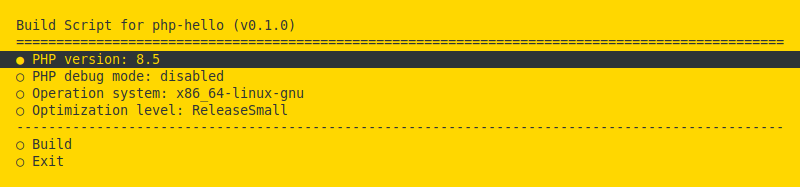
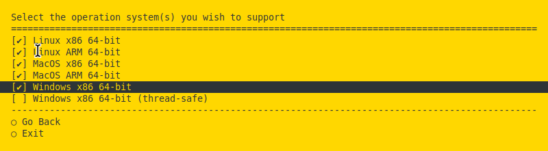
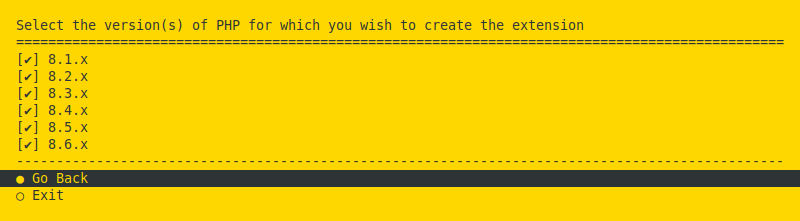

# ZPX

<picture>
    <source media="(max-width:500px)" srcset="img/logo-large.png">
    
</picture>

ZPX (Zig PHP eXtension) is a framework for creating PHP extensions using the Zig programming 
language. It's designed, first and foremost, with ease of development in mind. Set-up is simple.
The framework has no dependencies aside from the Zig compiler and PHP itself. You do not need 
to install phpize or the C tool-chain. Deployment of your extension will be easy too. Thanks to 
Zig's powerful cross-platform capability, you can compile for a Linux server from a Mac or a 
Windows PC.

The goal of the project is to enable everyday PHP programmers to create custom extensions in a
matter of hours.

ZPX is designed for Zig 0.17.0+ and supports PHP 8.1 through 8.6.

Version 0.17.1 is being prepared right now. It'll be released in the coming days.

## Getting started

First, install the Zig compiler if it's not on your computer. The easiest way is using 
[zvm](https://github.com/tristanisham/zvm#installing-zvm), the Zig Version Manager.

Then download the latest package from this project's 
[release page](https://github.com/chung-leong/zpx/releases). Unzip it into a directory,
change to it in a terminal and run `./build`. The build script will download the PHP SDK 
for the current version of PHP and compile the default "hello" extension. After a minute or so,
you should see the path of the end product:

```
Building extension at optimization level "ReleaseSmall" for PHP 8.5 (linux/x86_64)
Created 1 dynamic-linked library:

extensions/8.5/php_hello.so
```

You can test the extension with following command:

```sh
php -d extension=extensions/8.5/php_hello.so -r "greet('Alice');"
```
```
Hello, Alice!
```

## Compiling for different platforms

Run `./build menu` to activate the build menu:



It lets you to select multiple platforms to compile the extension for:



You can also compile for multiple versions of PHP--all at once:



The information you entered is saved to `build.ini`. Your selection will be used again when you 
run `./build`.

Note: On Windows, the menu only works when you launch it in Git Bash.

## Examining the code

Let us look at the actual code. First, the extension's entry point:

**src/main.zig**:

```zig
const std = @import("std");
const config = @import("config");
const php = @import("php/root.zig");

var module: php.Module.Custom(@import("Extension.zig"), .{
    // ext name and version are extracted from composer.json by build.zig
    .name = config.ext_name,
    .version = config.ext_version,
}) = .init();
comptime {
    module.register();
}

pub fn DllMain(
    _: std.os.windows.HINSTANCE,
    _: std.os.windows.DWORD,
    _: std.os.windows.LPVOID,
) std.os.windows.BOOL {
    return if (php.linkWindowsImports()) |_| .TRUE else |_| .FALSE;
}
```

`Module.Custom` is a parametric struct type for defining an extension. It accepts a struct type 
and an option struct as arguments. The struct is defined in `Extension.zig`. This is the file 
you'll be modifying to create your own extension.

**src/Extension.zig**:

```zig
const php = @import("php/root.zig");
const getter = php.IniEntry.getter;
const setter = php.IniEntry.setter;

pub const @"export CONSTANT" = "Hello world";
pub const @"export Enum" = enum { hello, world };

pub fn @"call greet"(self: *@This(), args: struct {
    name: []const u8,
}) !void {
    php.print("{s}, {s}!\n", .{ self.greeting, args.name });
}

pub const @"get greeting" = getter(@This(), .greeting);
pub const @"set greeting" = setter(@This(), .greeting);

greeting: [:0]const u8 = "Hello",
```

The function we called earlier, `greet()`, is defined by `@"call greet"()`. The `@"call ..."` 
prefix indicates a function is meant to be used in PHP. Arguments from PHP are contained in a 
struct. In this case we have a single one, which is expected to be a string.

The `self` argument points to a struct containing the extension's settings. If we run the 
following command:

```sh
php -d extension=extensions/8.5/php_hello.so -r "ini_set('hello.greeting', 'Ahoj'); greet('Alice');"
```

We would get this:

```
Ahoj, Alice!
```

Ini entries are accessed through getters and setters. We use `php.IniEntry.getter` and
`php.IniEntry.setter` to generate generic functions for this purpose. The above declarations are
equivalent to:

```zig
pub fn @"get greeting"(self: *@This()) [:0]const u8 {
    return self.greeting;
}

pub fn @"set greeting"(self: *@This(), value: [:0]const u8) void {
    self.greeting = value;
}
```

The `@"export ..."` prefix is used to add constants and 
[enumerations](https://www.php.net/manual/en/language.types.enumerations.php) specific to the 
extension. It's also used for adding custom classes. We'll get to that in later sections.

## Documentation

* [User guide and tutorials](https://github.com/chung-leong/zpx/wiki)
* [API references]()


## Complete examples

* [Typed Array](https://github.com/chung-leong/zpx/tree/main/examples/typed-array) - An implementation of JavaScript's typed arrays
