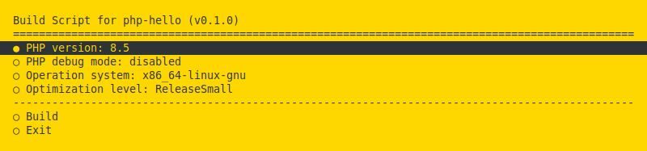
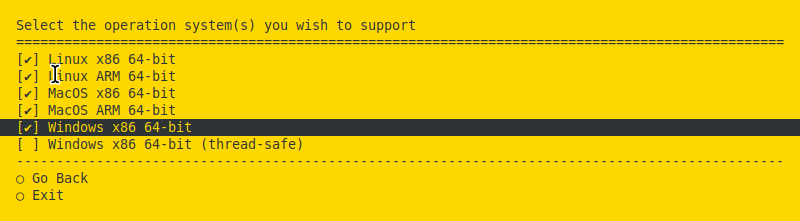
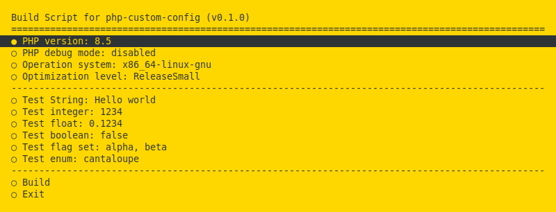

# zig-php-ext

Zig-php-ext is a framework for creating PHP extensions using the Zig programming language. It's 
designed, first and foremost, with ease of development in mind. Set-up is simple. The framework
has no dependencies aside from the Zig compiler and PHP itself. You do not need to install the 
C tool-chain or phpize. Deployment of your extension will be easy too. Thanks to Zig's powerful
cross-platform capability, you can compile for a Linux server from a Mac or a Windows PC.

The goal of the project is to enable everyday PHP programmers to create custom extensions in a
matter of hours.

Zig-php-ext is designed for Zig 0.17.0 and supports PHP 8.1 through 8.6.

## Getting started

First, install the Zig compiler if it's not on your computer. The easiest way is using 
[zvm](https://github.com/tristanisham/zvm#installing-zvm), the Zig Version Manager.

Then download the latest package from this project's 
[release page](https://github.com/chung-leong/zig-php-ext/releases). Unzip it into a directory,
change to it in a terminal and run `php build.php`. The build script will download the PHP SDK 
for the current version of PHP and compile the default "hello" extension. After a minute or so,
you should see the path of the end product:

```
Building extension at optimization level "ReleaseSmall" for PHP 8.5 (linux/x86_64)
Created 1 dynamic-linked library:

extensions/8.5/php_hello.so
```

You can test the extension with following command:

```sh
php -d extension=extensions/8.5/php_hello.so -r "greet('Alice');"
```
```
Hello, Alice!
```

## Compiling for different platforms

Run `php build.php menu` to activate the build menu:



It lets you to select multiple platforms to compile the extension for:



The information you entered is saved to `build.ini`. Your selection will be used again when you 
run `php build.php`.

Note: On Windows, the menu only works when you launch it in Git Bash.

## Examining the code

Let us look at the actual code. First, the extension's entry point:

**src/main.zig**:

```zig
const std = @import("std");

const config = @import("config");

const php = @import("php/root.zig");

var module: php.Module.Custom(@import("extension.zig"), .{
    // ext name and version are extract from composer.json by build.zig
    .name = config.ext_name,
    .version = config.ext_version,
}) = .init();
comptime {
    module.register();
}

pub fn DllMain(
    _: std.os.windows.HINSTANCE,
    _: std.os.windows.DWORD,
    _: std.os.windows.LPVOID,
) std.os.windows.BOOL {
    return if (php.linkWindowsImports()) |_| .TRUE else |_| .FALSE;
}
```

`Module.Custom` is a parametric struct type for defining an extension. It accepts a struct type 
and an option struct as arguments. The namespace is defined in `extension.zig`. This 
is the file you'll be modifying to create your own extension.

**src/extension.zig**:

```zig
const php = @import("php/root.zig");
const getter = php.IniEntry.getter;
const setter = php.IniEntry.setter;

pub const @"export CONSTANT" = "Hello world";
pub const @"export Enum" = enum { hello, world };

pub fn @"call greet"(self: *@This(), args: struct {
    name: []const u8,
}) !void {
    php.print("{s}, {s}!\n", .{ self.greeting, args.name });
}

pub const @"get greeting" = getter(@This(), .greeting);
pub const @"set greeting" = setter(@This(), .greeting);

greeting: [:0]const u8 = "Hello",
```

The function we called earlier, `greet()`, is defined by `@"call greet"()`. The `@"call` prefix indicates
a function is meant to be used in PHP. Arguments from PHP are contained in a struct. In this case
we have a single one, which is expected to be a string.

The `self` argument points to a struct containing the extension's settings. If we run the following command:

```sh
php -d extension=extensions/8.5/php_hello.so -r "ini_set('hello.greeting', 'Hi'); greet('Alice');"
```

We would get this:

```
Ahoj, Alice!
```

Ini entries are accessed through getters and setters. We use `php.IniEntry.getter` and
`php.IniEntry.setter` to generate generic functions for this purpose. The above declarations are
equivalent to:

```zig
pub fn @"get greeting"(self: *@This()) [:0]const u8 {
    return self.greeting;
}

pub fn @"set greeting"(self: *@This(), value: [:0]const u8) void {
    self.greeting = value;
}
```

The `@"export"` prefix is used to add constants and 
[enumerations](https://www.php.net/manual/en/language.types.enumerations.php) specific to the 
extension. It's also used for adding custom classes. We'll get to that in later sections.

## Receiving arguments of different types

We can use Zig [tagged unions](https://ziglang.org/documentation/0.17.0/#Tagged-union) to receive 
arguments of different types:

```zig
pub fn @"call greet"(self: *@This(), args: struct {
    recipient: union(enum) {
        one: []const u8,
        multiple: [][]const u8,
    },
}) !void {
    switch (args.recipient) {
        .one => |name| php.print("{s}, {s}!\n", .{ self.greeting, name }),
        .multiple => |names| for (names) |name| {
            php.print("{s}, {s}!\n", .{ self.greeting, name });
        },
    }
}
```
```php
<?php

greet('Alice');
greet([ 'Bob', 'Charlie', 'Dan' ]);

?>
```
```
Hello, Alice!
Hello, Bob!
Hello, Charlie!
Hello, Dan!
```

## Reporting errors

Use Zig's standard error mechanism to trigger exceptions on the PHP side:

```zig
pub fn @"call greet"(self: *@This(), args: struct {
    recipient: union(enum) {
        one: []const u8,
        multiple: [][]const u8,
    },
}) !void {
    switch (args.recipient) {
        .one => |name| php.print("{s}, {s}!\n", .{ self.greeting, name }),
        .multiple => |names| for (names) |name| {
            if (std.mem.eql(u8, name, "Dan")) {
                return error.TheManIsDeaf;
            }
            php.print("{s}, {s}!\n", .{ self.greeting, name });
        },
    }
}
```
```php
<?php

greet('Alice');
greet([ 'Bob', 'Charlie', 'Dan' ]);

?>
```
```
Hello, Alice!
Hello, Bob!
Hello, Charlie!
PHP Fatal error:  Uncaught Exception: the man is deaf in /home/cleong/zig-php-ext/examples/hello/test.php:4
```

## Extension name and version

By now, we've exhausted the demonstrative possibities of our simple "hello" extension. Let us 
change it so it does something more useful. We want to make a function that calculates the hash
of the given data using the 
[CityHash](https://opensource.googleblog.com/2011/04/introducing-cityhash.html) algorithm. We'll 
start by changing the name of our extension. This information is retrieved from `composer.json`:

```json
{
    "name": "mycompany\/hello",
    "description": "A description of my application",
    "version": "0.1.0"
}
```

We'll change the name to "city-hash" and bump the version number up to 0.17.0:

```json
{
    "name": "mycompany\/city-hash",
    "description": "A description of my application",
    "version": "0.17.0"
}
```

Now we'll to get a library file named `php_city_hash.so` (`.dll` on Windows, `.dylib` on MacOS).

## Returning strings

Replace the code in `src/extension.zig`, with the following:

```zig
const std = @import("std");
const CityHash64 = std.hash.cityhash.CityHash64;

const php = @import("php/root.zig");

pub fn @"call city_hash"(_: *@This(), args: struct {
    data: []const u8,
}) !*u64 {
    return CityHash64.hash(args.data);
}
```

Create `test.php`:

```php
<?php

echo city_hash("Hello world!"), "\n";

?>
```

And run it:

```
php -d extension=extensions/8.5/php_city_hash.so test.php
```
```
8483183195033020432
```

Here, we're simply using a function built into Zig's standard library to calculate the hash.
The result is a 64-bit unsigned number. Since we most often use the hexdecimal representation of 
hashes, a function that returns a string would be more ergonomic. 

Strings introduce added complications because they're variable-length. Their creation requires
memory allocation. We have to be mindful of memory ownership therefore. Zig-php-ext follows the 
standard approach in Zig: unless a function receives an allocator from the caller, it should not
assume memory will get freed by the caller.

The following code will result in a memory leak:

```zig
const std = @import("std");
const CityHash64 = std.hash.cityhash.CityHash64;

const php = @import("php/root.zig");

pub fn @"call city_hash"(_: *@This(), args: struct {
    data: []const u8,
}) ![]const u8 {
    const hash = CityHash64.hash(args.data);
    return std.fmt.allocPrint(php.allocator, "{x}", .{hash});
}
```

For this situation, we need to return a PHP string instead:

```zig
const std = @import("std");
const CityHash64 = std.hash.cityhash.CityHash64;

const php = @import("php/root.zig");

pub fn @"call city_hash"(_: *@This(), args: struct {
    data: []const u8,
}) *php.String {
    const hash = CityHash64.hash(args.data);
    return .allocPrint("{x}", .{hash});
}
```

Strings, arrays, and objects in PHP are reference-counted. Here, a string with refcount = 1 
gets returned to PHP. When PHP is done with it, it'll decrement the refcount to zero and the 
memory allocated for the string will be released.

With our new code we get the following output:

```
75ba522b8881a810
```

## Accepting optional arguments

Suppose we want to give the user of our hash function the option to specify a seed. We also 
want them to be able to choose between upper-case or lower-case output. To do that, we just need 
to provide default values to these arguments in the struct:

```zig
const std = @import("std");
const CityHash64 = std.hash.cityhash.CityHash64;

const php = @import("php/root.zig");

pub fn @"call city_hash"(_: *@This(), args: struct {
    data: []const u8,
    seed: ?u64 = null,
    uppercase: bool = false,
}) *php.String {
    const hash = if (args.seed) |seed|
        CityHash64.hashWithSeed(args.data, seed)
    else
        CityHash64.hash(args.data);
    return switch (args.uppercase) {
        true => .allocPrint("{X}", .{hash}),
        false => .allocPrint("{x}", .{hash}),
    };
}
```
```php
<?php

echo city_hash("Hello world!"), "\n";
echo city_hash("Hello world!", 0x1234, true), "\n";

?>
```
```
75ba522b8881a810
8604784A83200D0D
```

## Accepting named arguments

Another way of doing optional arguments is with named arguments. Zig-php-ext passes extra named 
arguments (i.e. arguments whose names do not match those of the function's declared arguments)
as an associative array to the function handler as its final argument. This array can be used to
initialize an optional struct:

```zig
const std = @import("std");
const CityHash64 = std.hash.cityhash.CityHash64;

const php = @import("php/root.zig");

const Options = struct {
    seed: ?u64 = null,
    uppercase: bool = false,
};

pub fn @"call city_hash"(_: *@This(), args: struct {
    data: []const u8,
    options: Options = .{},
}) *php.String {
    const hash = if (args.options.seed) |seed|
        CityHash64.hashWithSeed(args.data, seed)
    else
        CityHash64.hash(args.data);
    return switch (args.options.uppercase) {
        true => .allocPrint("{X}", .{hash}),
        false => .allocPrint("{x}", .{hash}),
    };
}
```
```php
<?php

echo city_hash("Hello world!"), "\n";
echo city_hash("Hello world!", uppercase: true), "\n";

?>
```
```
75ba522b8881a810
75BA522B8881A810
```

This technique is useful in situations where the number of optional arguments is large.

## Accepting struct arguments

When an argument is a struct, on the PHP side you specify it using an associative array:

```zig
const php = @import("php/root.zig");

const Power = enum { tech, mutant, occult, alien, training };

const Avenger = struct {
    real_name: []const u8,
    superhero_name: []const u8,
    power: Power = .training,
};

pub const @"export Power" = Power;

pub fn @"call show"(_: *@This(), args: struct {
    avenger: Avenger,
}) !void {
    php.print("{s} = {s} ({})\n", .{
        args.avenger.superhero_name,
        args.avenger.real_name,
        args.avenger.power,
    });
}
```
```php
<?php

show([ 'real_name' => "Tony Stark", 'superhero_name' => "Ironman", 'power' => Power::tech ]);

?>
```
```
Ironman = Tony Stark (.tech)
```

```php
<?php

class Superhero {
    function __construct($real_name, $superhero_name, $power) {
        $this->real_name = $real_name;
        $this->superhero_name = $superhero_name;
        $this->power = $power;
    }
}

show(new Superhero("Tony Stark", "Ironman", 'tech'));

?>
```
```
Ironman = Tony Stark (.tech)
```

A function can also accepts a list of objects:

```zig
pub fn @"call assemble"(_: *@This(), args: struct {
    avengers: []Avenger,
}) !void {
    for (args.avengers) |a| {
        php.print("{s} = {s} ({})\n", .{
            a.superhero_name,
            a.real_name,
            a.power,
        });
    }
}
```
```php
<?php

assemble([
    [ 'real_name' => "Tony Stark", 'superhero_name' => "Ironman", 'power' => 'tech' ],
    [ 'real_name' => "Natalia Romanov", 'superhero_name' => "Black Widow" ],
    [ 'real_name' => "Peter Parker", 'superhero_name' => "Blue Beetle", 'power' => 'mutant' ],
]);

?>
```
```
Ironman = Tony Stark (.tech)
Black Widow = Natalia Romanov (.training)
Blue Beetle = Peter Parker (.mutant)
```

Notice that enum can accept either a integer or a string.

## Returning structs

When a function returns a struct, it gets converted to a `stdclass`:

```zig
pub fn @"call get"(_: *@This(), _: struct {}) !Avenger {
    return .{
        .superhero_name = "Captain America",
        .real_name = "Steve Rogers",
    };
}
```
```php
<?php

print_r(get());

?>
```
```
stdClass Object
(
    [real_name] => Steve Rogers
    [superhero_name] => Captain America
    [power] => 4
)
```

You can also return an array of structs:

```zig
pub fn @"call get_two"(_: *@This(), _: struct {}) ![2]Avenger {
    return .{
        .{
            .superhero_name = "Captain America",
            .real_name = "Steve Rogers",
        },
        .{
            .superhero_name = "Ironman",
            .real_name = "Tony Stark",
            .power = .tech,
        },
    };
}
```
```php
<?php

print_r(get_two());

?>
```
```
Array
(
    [0] => stdClass Object
        (
            [real_name] => Steve Rogers
            [superhero_name] => Captain America
            [power] => 4
        )

    [1] => stdClass Object
        (
            [real_name] => Tony Stark
            [superhero_name] => Ironman
            [power] => 0
        )

)
```

If the array is variable-length, you'll need to create a PHP array manually and return that:

```zig
pub fn @"call get_multiple"(_: *@This(), args: struct {
    count: usize,
}) !*php.Array {
    const array: *php.Array = .create();
    for (0..args.count) |_| {
        array.append(.fromAny(.{
            .superhero_name = "Multiple Man",
            .real_name = "Jamie Madrox",
        }));
    }
    return array;
}
```
```php
<?php

print_r(get_multiple(5));

?>
```
```
Array
(
    [0] => stdClass Object
        (
            [superhero_name] => Multiple Man
            [real_name] => Jamie Madrox
        )

    [1] => stdClass Object
        (
            [superhero_name] => Multiple Man
            [real_name] => Jamie Madrox
        )

    [2] => stdClass Object
        (
            [superhero_name] => Multiple Man
            [real_name] => Jamie Madrox
        )

    [3] => stdClass Object
        (
            [superhero_name] => Multiple Man
            [real_name] => Jamie Madrox
        )

    [4] => stdClass Object
        (
            [superhero_name] => Multiple Man
            [real_name] => Jamie Madrox
        )

)
```

## Defining custom classes

The parametric type `php.Class.Custom` is used to define a custom class. It accepts a struct type 
as an argument. Used a `@"export [name]"` declaration to export the class. The name may include
a namespace: 

```zig
const std = @import("std");

const php = @import("php/root.zig");
const getter = php.Object.getter;
const setter = php.Object.setter;

pub const @"export marvel\\Avenger" = php.Class.Custom(struct {
    pub const @"export Power" = Power;

    pub const @"get real_name" = getter(@This(), .real_name);
    pub const @"set real_name" = setter(@This(), .real_name);
    pub const @"get superhero_name" = getter(@This(), .superhero_name);
    pub const @"set superhero_name" = setter(@This(), .superhero_name);

    pub fn @"get power"(self: *@This()) *php.String {
        return switch (self.power) {
            inline else => |tag| php.String.static(@tagName(tag)),
        };
    }

    pub fn @"set power"(self: *@This(), name: *php.String) !void {
        self.power = inline for (comptime std.meta.fieldNames(Power)) |field_name| {
            if (name.matchStatic(field_name)) break @field(Power, field_name);
        } else return error.InvalidPower;
    }

    pub fn @"call show"(self: *@This(), _: struct {}) !void {
        php.print("{s} = {s} ({})\n", .{
            self.superhero_name,
            self.real_name,
            self.power,
        });
    }

    const Power = enum { tech, mutant, occult, alien, training };

    real_name: []const u8 = "",
    superhero_name: []const u8 = "",
    power: Power = .training,
});
```
```
<?php

use marvel\Avenger;

$avenger = new Avenger("Ironman", "Tony Stark", "tech");
$avenger->show();
$avenger->power = 'mutant';
$avenger->show();

?>
```
```
Tony Stark = Ironman (.tech)
Tony Stark = Ironman (.mutant)
```

The code above defines the custom struct in an inline statement. Typically you would have the
definition in a separate file.

When the struct doesn't implement `init()` or `initSelf()`, the class's constructor would 
initialize its fields using its setters, with the arguments in the same order as the setters. In 
such a case, all fields must have default values. 

If implemented, the initialization function should be either 
`pub fn init(args: struct { ... }) !@This()` or 
`pub fn initSelf(self: *@This(), args: struct { ... }) !void`. The argument struct may be omitted.
Returning an error union is also optional. You'd need to implement `deinit()` as well. 

Named arguments can be used to initialize the object:

```php
<?php

$avenger = new Avenger(real_name: "Peter Parker", superhero_name: "Antman", power: "tech");
print_r($avenger);

?>
```
```
marvel\Avenger Object
(
    [real_name] => Peter Parker
    [superhero_name] => Antman
    [power] => tech
)
```

When the struct lacks a `iterate()` method, the default iteration method is used, which returns
results from the getter functions:

```php
<?php

$avenger = new Avenger(real_name: "Peter Parker", superhero_name: "Antman", power: "tech");
foreach ($avenger as $key => $value) {
    echo "$key = $value\n";
}

?>
```
```
real_name = Peter Parker
superhero_name = Antman
power = tech
```

## Defining sub-classes and enumerations

In the example in the previous section, `Power` appears in an `@"export..."` declaration within 
the class. This results in the enum being exported within the namespace of the class. A constant
is added to the class itself providing the full class path:

```php
<?php

echo Avenger::Power, "\n";

?>
```
```
marvel\Avenger\Power
```

Since strings can be used to reference classes in PHP, you can access the enum either through the 
class or import it separately:

```php
<?php

use marvel\Avenger\Power;

echo Avenger::Power::mutant, "\n";
echo Power::mutant, "\n";

?>
```
```
1
1
```

Sub-classes can be exported in the same manner.

## Passing arguments by reference

Use a pointer to `php.Value` if your function needs a by-ref argument:

```zig
const php = @import("php/root.zig");

pub fn @"call set_text"(_: *@This(), args: struct {
    value: *php.Value,
}) !void {
    args.value.release();
    args.value.* = .fromString(.static("Hello world"));
}
```
```php
<?php

set_text($text);
echo $text, "\n";

?>
```

`Value` represents a PHP variant (aka `zval`).

## Defining variadic function

If you want to define a function that accepts any number of arguments, you have to add the special
`@"..."` field to the argument struct:

```zig
const php = @import("php/root.zig");

pub fn @"call list_arguments"(_: *@This(), args: struct {
    arg0: u32,
    @"...": []const php.Value,
}) !void {
    php.print("arg1 = {d}\n", .{args.arg0});
    for (args.@"...") |arg| php.print("{}\n", .{arg.kind()});
}
```
```php
<?php

list_arguments(1234, 1, 2.5, "Hello world", false, null, (object) []);

?>
```
```
arg1 = 1234
.integer
.float
.string
.boolean
.null
.object
```

Add the `@"???"` field to the argument struct if you wish to get named arguments as well:

```zig
const php = @import("php/root.zig");

pub fn @"call list_arguments"(_: *@This(), args: struct {
    arg0: u32,
    @"...": []const php.Value,
    @"???": ?*php.Array,
}) !void {
    php.print("arg1 = {d}\n", .{args.arg0});
    for (args.@"...") |arg| php.print("{}\n", .{arg.kind()});
    if (args.@"???") |named| {
        var iter = named.iterate(.{});
        while (iter.next()) |n_arg| {
            php.print("{s} = {}\n", .{ iter.key().string().slice(), n_arg.kind() });
        }
    }
}
```
```php
<?php

list_arguments(4567, false, cow: 'tasty', chicken: 1234);

?>
```
```
arg1 = 4567
.boolean
cow = .string
chicken = .integer
```

## Custom menu items

You can add custom items to the build menu by adding a special entry in `composer.json`:



The menu shown above is rendered from the following `composer.json`:

```json
{
    "name": "mycompany/custom-config",
    "description": "A description of my application",    
    "version": "0.1.0",
    "zig": {
        "config": {
            "cfg_string": { 
                "title": "Test String",
                "description": "Configuration option that is a string",
                "prompt": "Enter a string",
                "default": "Hello world"
            },
            "cfg_int": { 
                "title": "Test integer",
                "type": "usize",
                "description": "Configuration option that is an integer",
                "prompt": "Enter an integer",
                "default": 1234
            },
            "cfg_float": { 
                "title": "Test float",
                "type": "f64",
                "description": "Configuration option that is a float",
                "prompt": "Enter an float",
                "default": 0.1234
            },
            "cfg_bool": { 
                "title": "Test boolean",
                "description": "Configuration option that is a boolean",
                "default": false
            },
            "cfg_flag": { 
                "title": "Test flag set",
                "description": "Configuration option flag",
                "prompt": "Set one or more",
                "type" : "Flag",
                "choices": { 
                    "alpha": "Alpha",
                    "beta": "Beta",
                    "gamma": "Gamma"
                },
                "default": [ "alpha", "beta" ]
            },
            "cfg_enum": { 
                "title": "Test enum",
                "description": "Configuration option that is an enum",
                "prompt": "Select one",
                "type" : "Enum",
                "choices": {
                    "apple": "You like apple",
                    "banana": "You like banana", 
                    "cantaloupe": "You hate cantaloupe" 
                },
                "default": "cantaloupe"
            }
        }
    }
}
```

These custom fields are available at comptime in `@import("config")`. Typically, the namespace 
would only contain the extension name and version.

When `choices` is present, the end-user will be presented with a list of possible choices.

`prompt` and `title` are text strings that appears in the build menu.

The `description` field is entirely optional. It's only shown if the end-user chooses to run 
`zig build --help`:

```
Project-Specific Options:
  -Doptimize=[enum]            Prioritize performance, safety, or binary size
                                 Supported Values:
                                   debug
                                   safe
                                   fast
                                   small
  -Dtarget=[string]            The CPU architecture, OS, and ABI to build for
  -Dcpu=[string]               Target CPU features to add or subtract
  -Dofmt=[string]              Target object format
  -Ddynamic-linker=[string]    Path to interpreter on the target system
  -Dphp-include=[string]       Directory containing PHP header files
  -Dphp-extension=[string]     Directory where the extension will be saved
  -Dphp-debug=[bool]           Whether PHP executable has debug enabled
  -Dphp-ts=[bool]              Whether PHP executable was compiled with thread-safety enabled
  -Dcfg_string=[string]        Configuration option that is a string
  -Dcfg_int=[int]              Configuration option that is an integer
  -Dcfg_float=[float]          Configuration option that is a float
  -Dcfg_bool=[bool]            Configuration option that is a boolean
  -Dcfg_flag_alpha=[bool]      Configuration option flag: alpha
  -Dcfg_flag_beta=[bool]       Configuration option flag: beta
  -Dcfg_flag_gamma=[bool]      Configuration option flag: gamma
  -Dcfg_enum=[enum]            Configuration option that is an enum
                                 Supported Values:
                                   apple
                                   banana
                                   cantaloupe
```

In its absence, `prompt` would be shown.

`type` is required when the value in question is an enum or a packed struct with boolean flags.
When used, you have to provide the definition of the actual type in `composer.zig`. The `type` 
field is also needed when a floating point field's default value does not clearly indicate that 
the field is supposed to be a floating point number (i.e. when the default value is a whole 
number).

## Packaging your extension

Run `php package.php` in the extension's root directory to package the source code in a zip file.
The script will exclude files in the `test` directory and unnecessary packages in the `vendor`
directory like PHPUnit.